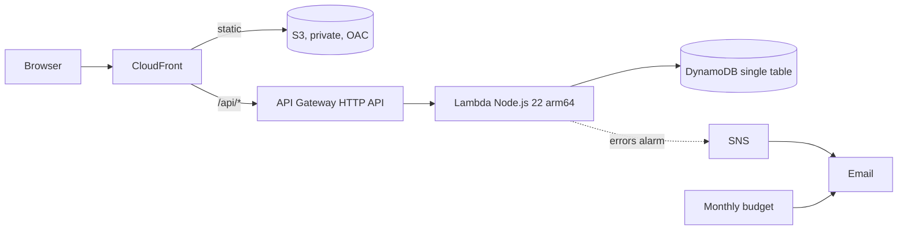

# 💀 Skeleton Crew: a serverless app skeleton for Kiro

**Kiroween 2026 · Category: Skeleton Crew**

One lean skeleton for AWS serverless web apps, one standard procedure, and a
Kiro setup (steering, hooks, specs) that makes every app come out the same way:
in its own AWS account, behind guardrails, reviewed before it touches the cloud.
The proof is two different apps in `apps/`, built from the same foundation with
the same pipeline.

## The problem
Starting a cloud app means re-deciding the same things every time: which
account, which architecture, how to deploy, how not to destroy production. An
AI agent makes the code fast but does not make those decisions safe by
itself. Skeleton Crew writes the decisions down once (as code, steering, and
hooks) so that the agent and the human follow them on every app.

## What every app gets



- **Its own AWS account** in the `Kiroween-2026` OU, with a project-only SCP
  (us-east-1 only, no IAM users or keys, protected deployer role and Terraform state)
- **React 19 + Vite + Tailwind CSS 4** frontend with switchable spooky themes
- **A config-driven API**: declare collections and fields in `app.config.json`;
  the Lambda serves validated CRUD for them and the UI renders forms for them
- **Terraform** with a per-account S3 backend, `allowed_account_ids`, DynamoDB
  deletion protection, least-privilege IAM, and security headers
- **Operations from day one**: API error alarm and a cost budget by email

## The pipeline (identical for every app)

```powershell
.\scripts\New-App.ps1     -Name ghost-guestbook -Description "Leave a message for the spirits." -Theme ghost
# write the app's spec in Kiro (requirements, design, tasks) and run the tasks
.\scripts\Plan-App.ps1    -Name ghost-guestbook    # impact summary with a risk level
.\scripts\Apply-App.ps1   -Name ghost-guestbook    # after an explicit "yes": applies exactly that plan
.\scripts\Publish-App.ps1 -Name ghost-guestbook    # build, upload, invalidate, smoke test
```

| Step | What happens |
|---|---|
| `New-App` | copies `skeleton/` to `apps/<name>`, fills in name, description, theme; vends the AWS account (`New-AppAccount`) |
| Spec | `.kiro/specs/<name>/`: requirements, design, tasks; Kiro builds in `apps/<name>` only |
| `Plan-App` | writes backend config, `terraform plan -out=tfplan`, prints CREATE / MODIFY / DESTROY / REPLACE and a risk level |
| `Apply-App` | applies the saved plan only; refuses stale plans and any delete or replace without a human's `-AllowDestroy` |
| `Publish-App` | builds, uploads with cache headers, invalidates CloudFront, checks the site and `/api/health` |

## How Kiro is used

### Steering (`.kiro/steering/`)
| File | Inclusion | What it teaches Kiro |
|---|---|---|
| `product.md`, `tech.md`, `structure.md` | always | what this is, the stack, where code goes |
| `aws-architecture.md` | always | serverless-only architecture, least privilege, validation, cost |
| `terraform-guardrails.md` | always | plan, present, explicit yes, saved-plan apply; what never to run |
| `deployment.md` | always | which command ships which change, what "deployed" means |
| `access.md` | always | GitHub and AWS identities, profiles, the OU |
| `aws-accounts.md` | auto | vending an account per app |
| `new-app.md` | auto | the standard new-app procedure |
| `app-config.md` | file match `app.config.json` | the config rules |
| `frontend.md` | file match `src/**` | styling tokens, accessibility, states |

### Hooks (`.kiro/hooks/`)
| Hook | Trigger | Effect |
|---|---|---|
| Infrastructure guardrails | PreToolUse, shell tools | blocks `terraform apply/destroy`, `-auto-approve`, state surgery, `-AllowDestroy`, and destructive AWS CLI calls (exit 2, with the reason sent back to Kiro) |
| Email the crew | PostTaskExec | each completed spec task emails the crew through SNS |
| App config changed | PostFileSave `app.config.json` | Kiro checks the config and reminds you how the change ships |

The pipeline scripts also email the crew when an app is scaffolded, applied, and published.

### Specs (`.kiro/specs/`)
- `skeleton-foundation/`: the skeleton's own requirements, design, and tasks
- one spec per app, written with the `new-app` procedure

## Repository layout
```
skeleton/        the template (app.config.json, src/, api/, infra/)
apps/            the apps built from it, one folder each
scripts/         the pipeline (Windows PowerShell 5.1)
platform/org/    the project SCP
.kiro/           steering, hooks, specs
docs/            WALKTHROUGH.md: the 20-minute live build
```

## Set up your own copy
Prerequisites: an AWS Organization (management account access), AWS CLI v2,
Terraform 1.7+, Node.js 22+, Git, GitHub CLI, Windows PowerShell 5.1+, Kiro.

```powershell
Copy-Item scripts\config.example.psd1 scripts\config.local.psd1   # fill it in
.\scripts\Setup-Org.ps1                    # OU Kiroween-2026 + project SCP (attached to that OU only)
.\scripts\New-AppAccount.ps1 -Name crew    # small account for the alert topic
.\scripts\Setup-CrewAlerts.ps1             # confirm the email AWS sends you
.\scripts\Setup-CrewAlerts.ps1 -Test
```
Then follow the pipeline above, or the full script in [docs/WALKTHROUGH.md](docs/WALKTHROUGH.md).

Accounts in the OU still inherit any SCPs on your Organization root; the project
SCP only adds to them and touches nothing outside the OU.

## Cost
Everything is pay-per-request. An idle app costs close to nothing; the budget
alert (default $10 a month per app) emails you before it is a surprise.

## License
[MIT](LICENSE)
